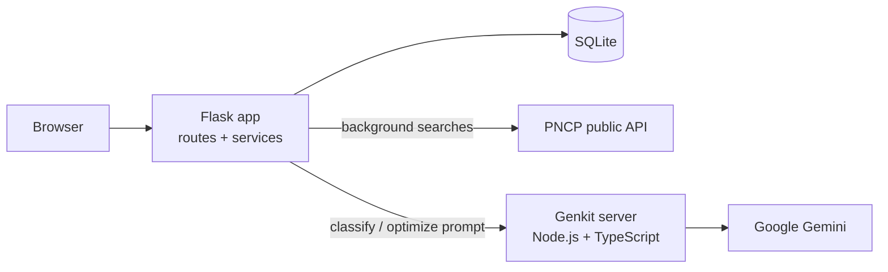

<div align="center">

# 🔍 Public Tender Search (PNCP)

### Find, monitor and AI-classify Brazilian public procurement notices

*A web app that searches the official PNCP API across many states at once, then uses an LLM with a company-specific prompt to say which tenders are actually worth bidding on.*


</div>

---

## The problem

Brazil publishes thousands of public tenders every day on the **PNCP** (Portal Nacional de Contratações Públicas). A supplier
needs to read hundreds of notices to find the few that match what the company sells. This project automates the search and
the first-pass triage.

## ✨ Features

- **Automated multi-state search** over the PNCP API, by keyword, with background execution.
- **Keyword management**: register, enable/disable and monitor terms of interest.
- **Advanced filters**: value, date, status, state, AI classification and flexible sorting.
- **AI classification**: each notice is rated *Suitable*, *Not suitable* or *Uncertain* using a prompt written for the company.
- **Prompt optimization**: the AI suggests improvements to the company's own classification prompt.
- **Opportunity tracking**: save tenders of interest and follow them.
- **Statistics dashboard**: volume of tenders found and classified.

## 🏗️ Architecture



| Layer | Technology |
|---|---|
| Backend | Python 3.9+ / Flask |
| Database | SQLite (schema + migrations in `database/`) |
| Data source | PNCP API (manuals included in `app/docs_API_PNCP/`) |
| AI | Firebase Genkit (Node.js/TypeScript) + Google Gemini |
| Frontend | Jinja2 templates + CSS + vanilla JS |

## 🚀 Quick start

```bash
git clone https://github.com/pjaragao/pesquisa_licitacoes.git && cd pesquisa_licitacoes
printf 'GOOGLE_GENAI_API_KEY=your_gemini_key\nGENKIT_PORT=3400\n' > .env   # key: https://aistudio.google.com/app/apikey
docker compose up --build        # open http://localhost:5000
```

Without Docker:

```bash
python -m venv venv && source venv/bin/activate && pip install -r requirements.txt
(cd genkit-server && npm install && npm run dev) &     # AI server
python main.py                                          # app on :5000
```

The database (`database/`) and downloaded documents (`downloads/`) persist through Docker volumes.

## 📂 Project structure

```text
main.py                       entry point
app/routes/api.py             pages + API routes
app/models/                   SQLite models
app/services/
  pncp_api_client.py          PNCP HTTP client
  pncp_search_service.py      search and filtering
  search_manager.py           background searches
  genkit_service.py           AI integration
  oportunidade_service.py     saved opportunities
database/                     schema and migrations
genkit-server/                AI server (Genkit / TypeScript)
```

---

<div align="center">

Built by **Paulo Aragão Jr** · [GitHub](https://github.com/pjaragao) · related project: [APP_PNCP](https://github.com/pjaragao/APP_PNCP)

</div>
